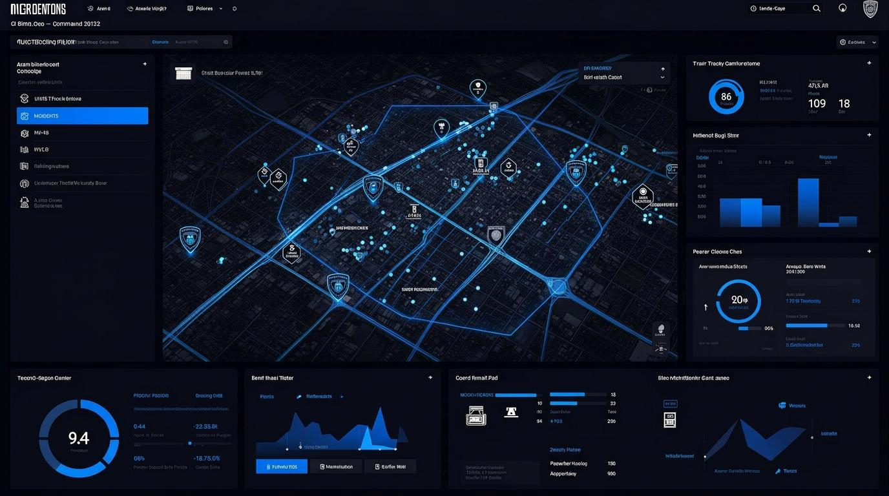
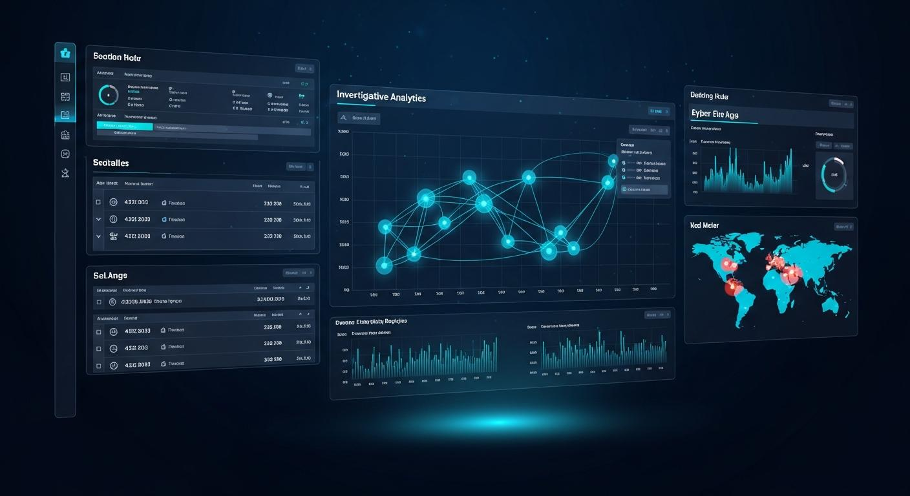
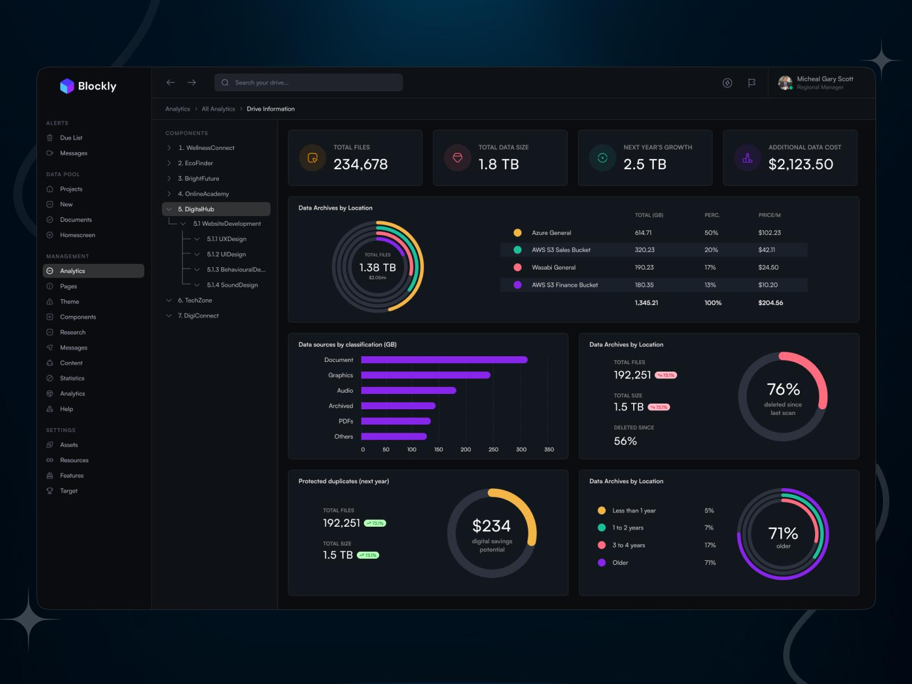
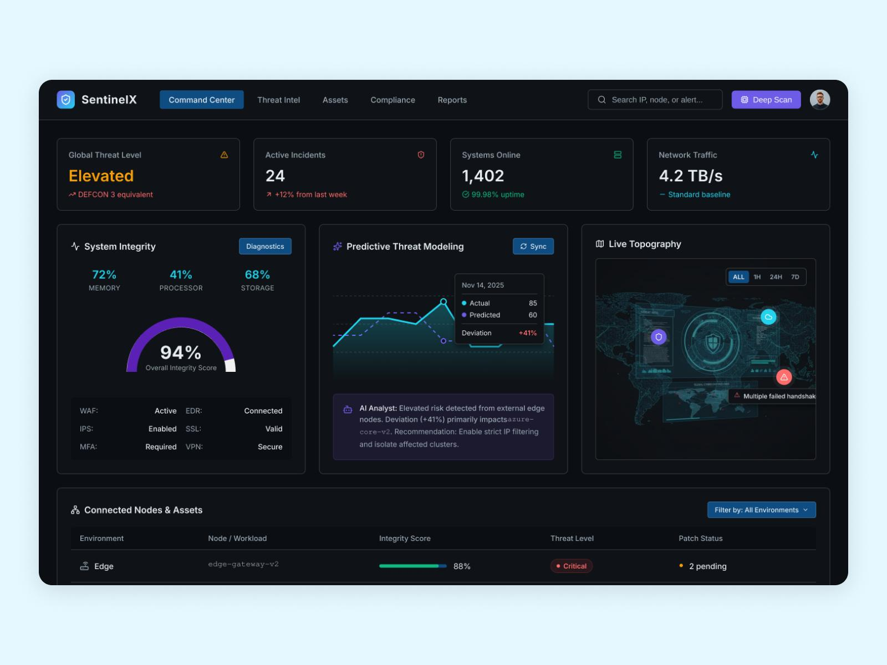
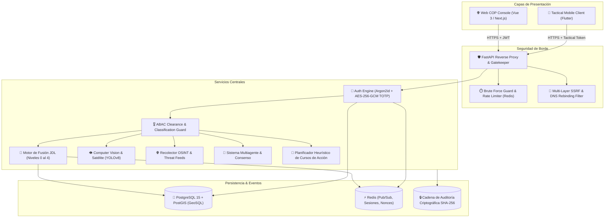

<div align="center">

```
  ███████╗███╗   ███╗ █████╗ ██████╗ ████████╗███╗   ██╗ █████╗ ████████╗██╗ ██████╗ ███╗   ██╗
  ██╔════╝████╗ ████║██╔══██╗██╔══██╗╚══██╔══╝████╗  ██║██╔══██╗╚══██╔══╝██║██╔═══██╗████╗  ██║
  ███████╗██╔████╔██║███████║██████╔╝   ██║   ██╔██╗ ██║███████║   ██║   ██║██║   ██║██╔██╗ ██║
  ╚════██║██║╚██╔╝██║██╔══██║██╔══██╗   ██║   ██║╚██╗██║██╔══██║   ██║   ██║██║   ██║██║╚██╗██║
  ███████║██║ ╚═╝ ██║██║  ██║██║  ██║   ██║   ██║ ╚████║██║  ██║   ██║   ██║╚██████╔╝██║ ╚████║
  ╚══════╝╚═╝     ╚═╝╚═╝  ╚═╝╚═╝  ╚═╝   ╚═╝   ╚═╝  ╚═══╝╚═╝  ╚═╝   ╚═╝   ╚═╝ ╚═════╝ ╚═╝  ╚═══╝
                      ██████╗ ███████╗███████╗███████╗███╗   ██╗███████╗███████╗
                      ██╔══██╗██╔════╝██╔════╝██╔════╝████╗  ██║██╔════╝██╔════╝
                      ██║  ██║█████╗  █████╗  █████╗  ██╔██╗ ██║███████╗█████╗  
                      ██║  ██║██╔══╝  ██╔══╝  ██╔══╝  ██║╚██╗██║╚════██║██╔══╝  
                      ██████╔╝███████╗██║     ███████╗██║ ╚████║███████║███████╗
                      ╚═════╝ ╚══════╝╚═╝     ╚══════╝╚═╝  ╚═══╝╚══════╝╚══════╝
```

### **SESIS-FEDERATION** — *Next-Gen Multi-Sensor Intelligence, C4ISR & Tactical Decision Support*

[](LICENSE)
[](reports/validation.json)
[](.factory/SECURITY_AUDIT.md)
[](docs/ARCHITECTURE_CURRENT.md)
[](docs/FINAL_VALIDATION_REPORT.md)

<p align="center">
  <b>Ingesta Multisensor</b> • <b>Fusión JDL (L0–L4)</b> • <b>Computer Vision & Satélite</b> • <b>OSINT Defensivo</b> • <b>Common Operating Picture (COP)</b>
  <br>
  <sub>Plataforma de ingeniería defensiva, analítica geoespacial y soporte algorítmico a la decisión humana.</sub>
</p>

---

</div>

> [!IMPORTANT]
> **AVISO DE RESPONSABILIDAD TÉCNICA Y OPERATIVA:**
> **SmartNationDefense** es un **prototipo de ingeniería de software, arquitectura de referencia e investigación tecnológica**.
> **NO ES UN SISTEMA DE COMBATE MILITAR EN PRODUCCIÓN ("Military-Grade Production")**.
> Todas las recomendaciones generadas por IA/LLM, simulaciones de wargaming y cursos de acción (COA) tienen carácter **ESTRICTAMENTE NO OPERATIVO / ASISTENCIA A LA DECISIÓN** y requieren **AUTORIZACIÓN HUMANA OBLIGATORIA (Human-in-the-Loop)** antes de cualquier ejecución en el mundo real.

> [!WARNING]
> **Estado de madurez: NO APROBADO PARA PRODUCCIÓN**
> El informe de validación ([`docs/FINAL_VALIDATION_REPORT.md`](docs/FINAL_VALIDATION_REPORT.md)) emite un veredicto global de **“NO APROBADO PARA PRODUCCIÓN”**. El gate de seguridad sí cerró **0 CRITICAL / 0 HIGH**, pero la validación es **parcial** y quedan bloqueos declarados:
>
> 1. **Docker no pudo ejecutarse** en el entorno de validación: la infraestructura (PostgreSQL/PostGIS, Redis, NATS, Neo4j, Nginx, Grafana/Alertmanager) está validada de forma **estática**, no en runtime real.
> 2. **Quedan dos cuestiones de seguridad abiertas** (MEDIUM, tareas `SEC-FIX-007` y `SEC-FIX-008`):
>    - **SEC-FIX-007 — hardening perimetral:** `/metrics` y `/docs` públicos si `METRICS_TOKEN` está vacío, Redis/NATS sin autenticación en el compose por defecto y cabeceras del frontend.
>    - **SEC-FIX-008 — integridad de auditoría y cobertura de rutas:** cabeza única de la cadena en DB bajo concurrencia y decisión explícita sobre los módulos OSINT no montados.
>    - Además, el MEDIUM más urgente es **VULN-035: el flujo MFA no se exige en las rutas vivas** (se implementa a nivel de librería/modelo, pero el login activo no lo demanda).
>
> **Uso previsto:** laboratorio, formación, evaluación técnica, investigación y referencia arquitectónica. **No desplegar en infraestructura crítica real** hasta cerrar los bloqueos anteriores y ejecutar la validación con Docker.

---

## 🖼️ Galería — Concept UI

> Referencias visuales de diseño (**concept art**). No son capturas del runtime actual: la interfaz implementada vive en `frontend/` con sus propios tokens y estados reales.

<table>
  <tr>
    <td></td>
    <td></td>
  </tr>
  <tr>
    <td align="center"><b>COP táctico</b> — mapa, unidades, amenazas y estado de misión</td>
    <td align="center"><b>Analítica de inteligencia</b> — grafo de entidades y series temporales</td>
  </tr>
  <tr>
    <td></td>
    <td></td>
  </tr>
  <tr>
    <td align="center"><b>Consola de seguridad</b> — integridad, amenaza predictiva y topología</td>
    <td align="center"><b>Analítica de datos</b> — inventario, clasificación y almacenamiento</td>
  </tr>
</table>

---

## ⚡ Aspectos Destacados del Sistema

<div align="center">

| 🛰️ **Fusión Multisensor** | 👁️ **Visión Táctica** | 🛡️ **Ciberseguridad Endurecida** | 📱 **Cliente de Campo** |
|:---:|:---:|:---:|:---:|
| Pipeline JDL L0–L4 correlacionando radar, AIS, satélite y OSINT | Inferencia YOLOv8, cálculo NDVI multiespectral y detección de cambios | AES-256-GCM, tickets MFA aislados y SSRF con IP pinning (0 CRITICAL/HIGH; MEDIUM residuales) | Flutter táctico offline-first, Duress PIN y sincronización resiliente |

```mermaid
flowchart LR
    subgraph SENSORES["📡 Fuentes de Ingesta"]
        direction TB
        S1["🛰️ Satélite (Sentinel/PAZ)"]
        S2["📡 Radar Costero / Aéreo"]
        S3["🚢 Telemetría AIS / ADSB"]
        S4["🌐 OSINT & DarkWeb RSS"]
    end

    subgraph ENGINE["🧠 Núcleo de Fusión & Análisis"]
        direction TB
        F0["L0: Filtro & Normalización WGS84"]
        F1["L1: Correlación Espacio-Temporal"]
        F2["L2: Evaluación de Situación"]
        CV["👁️ Computer Vision (YOLOv8)"]
        COA["🎯 Motor Heurístico de COAs"]
        ABAC["🔐 ABAC Clearance Matrix"]
    end

    subgraph VISUAL["🖥️ Interfaz Táctica"]
        direction TB
        COP["🗺️ Common Operating Picture"]
        TAC["📱 Flutter Tactical App"]
        AUDIT["📜 Cadena SHA-256 Inmutable"]
    end

    SENSORES --> F0
    F0 --> F1
    F1 --> F2
    SENSORES --> CV
    CV --> F1
    F2 --> COA
    COA --> ABAC
    ABAC --> COP
    ABAC --> TAC
    ABAC --> AUDIT

    classDef sensor fill:#0f172a,stroke:#00f0ff,stroke-width:1px,color:#fff;
    classDef engine fill:#1e1b4b,stroke:#6366f1,stroke-width:1px,color:#fff;
    classDef visual fill:#064e3b,stroke:#10b981,stroke-width:1px,color:#fff;

    class S1,S2,S3,S4 sensor;
    class F0,F1,F2,CV,COA,ABAC engine;
    class COP,TAC,AUDIT visual;
```

</div>



---

## 🌍 Casos de Uso Civiles

El mismo núcleo de fusión, análisis y coordinación puede aplicarse a misión civil. Los siguientes escenarios son **referencias de diseño y evaluación**, no despliegues reales:

| Caso de uso | Qué aporta la plataforma | Capacidades implicadas |
|---|---|---|
| **🏭 Protección de infraestructuras críticas** | Vigilancia perimetral y correlación de sensores (radar, satélite, dron, OSINT) para detectar aproximaciones, cambios de terreno u obras no autorizadas en plantas, puertos, presas y subestaciones. | Fusión JDL L0–L3, visión YOLOv8 + NDVI, alertas y auditoría hash-chain. |
| **🚢 Conocimiento de la situación marítima (MDA)** | Correlación de trazas AIS/radar con detecciones ópticas para identificar buques sin transpondedor, patrones anómalos o incidentes en aguas de responsabilidad. | Ingesta AIS, asociación espacio-temporal, detección de formaciones navales, mapas tácticos. |
| **📡 Resiliencia de comunicaciones** | Operación degradada: cola offline en el terminal móvil, reintentos y *dead-letter queue* en NATS, y sincronización al recuperar enlace para que la coordinación no se detenga. | Flutter offline-first, `offline_queue`, NATS DLQ + idempotencia, healthchecks. |
| **🔎 Análisis de información** | Triaje y enriquecimiento de fuentes abiertas (OSINT), extracción documental, grafos de entidades y generación de informes trazables para analistas humanos. | OSINT defensivo, extracción de documentos, grafo de entidades, audit chain. |
| **🚨 Coordinación ante emergencias** | COP compartido con estado de unidades, amenazas y recursos; reportes y *After Action Review* para que distintos organismos trabajen sobre la misma situación. | COP web, mensajería, reportes/AAR, roles y clearance, panel de observabilidad. |

> **Límite honesto:** estas capacidades están implementadas o integradas en distinto grado (ver [`docs/FEATURE_MATRIX.md`](docs/FEATURE_MATRIX.md)); varias dependen de servicios externos y del despliegue completo que aún no se ha validado en runtime (Docker). No sustituyen procedimientos oficiales de emergencia ni decisiones humanas.

---

## 🔬 Estado de Validación & Auditoría Técnica

El proyecto ha sido auditado de forma integral; el informe de validación ([`docs/FINAL_VALIDATION_REPORT.md`](docs/FINAL_VALIDATION_REPORT.md)) concluye **NO APROBADO PARA PRODUCCIÓN** por validación parcial (Docker no ejecutado y dos cuestiones de seguridad abiertas). Cifras de la **última ejecución reproducible**: **169 pruebas backend** (157 documentadas en el informe FASE 9 + 12 regresiones de seguridad añadidas en el cierre) y **11 pruebas móviles**.

```
╔═══════════════════════════════════════════════════════════════════════════════════════╗
║                             RESUMEN DE VERIFICACIÓN                                   ║
╠══════════════════════════════╦══════════════════════╦═════════════════════════════════╣
║ Métrica                      ║ Resultado            ║ Verificación                    ║
╠══════════════════════════════╬══════════════════════╬═════════════════════════════════╣
║ Tests backend                ║ 169 PASSED / 0 FAILED║ pytest 8.3.4 · 23 suites        ║
║ Tests móviles                ║ 11 PASSED / 0 FAILED ║ flutter test (3.24.5)           ║
║ Cobertura suites seguridad   ║ 88% (pytest-cov)     ║ 6 módulos críticos              ║
║ Móvil (Flutter 3.24.5)       ║ 0 issues             ║ flutter analyze                 ║
║ SCA (pip-audit / npm audit)  ║ 0 HIGH producción    ║ allowlist documentada           ║
║ Cifrado Secretos MFA         ║ AES-256-GCM          ║ Verificado en reposo            ║
║ Aislamiento Desafío MFA      ║ type="mfa_challenge" ║ Imposible bypass de endpoints   ║
║ Integridad de Auditoría      ║ SHA-256 Chain + Lock ║ Detección de manipulación       ║
║ Mitigación SSRF              ║ RFC Denylist Estricto║ 0.0.0.0/8, CGNAT, Metadata, IP6 ║
║ Control de Acceso            ║ ABAC (5 Niveles)     ║ 141 rutas v1+v3 sin gaps        ║
║ Infra Docker                 ║ NO EJECUTADO         ║ Sin Docker en el entorno        ║
║ Estado Global                ║ NO APTO PRODUCCIÓN   ║ Prototipo de referencia         ║
╚══════════════════════════════╩══════════════════════╩═════════════════════════════════╝
```

> **Nota sobre las cifras:** el informe FASE 9 documenta **157 tests backend**; después se añadieron **12 pruebas de regresión de seguridad** (Host/IP, identity bucket, métricas, YOLO, lockout), por lo que la suite actual es **169**. Ambas cifras son reales y se refieren a momentos distintos del cierre.

---

## 🏛️ Arquitectura Modular (As-Built)



---

## 🚀 Capacidades Principales

### 🧬 1. Fusión de Información Multisensor (JDL)
* **Nivel 0 (Señal):** Normalización de coordenadas, filtrado geodésico WGS84 (`EPSG:4326`) y acondicionamiento de datos crudos.
* **Nivel 1 (Objeto):** Asociación espacio-temporal cinemática mediante distancia Haversine y correlación de vectores velocidad/rumbo.
* **Nivel 2 (Situación):** Detección heurística de formaciones, convoyes terrestres y agrupaciones navales.
* **Nivel 3 (Impacto):** Estimación de riesgo perimétrico y vectores de aproximación a zonas críticas.
* **Nivel 4 (Proceso):** Sugerencias analíticas de reasignación y priorización de sensores.

### 👁️ 2. Visión Computacional & Analítica Satelital
* **Detección Táctica:** Inferencia local con YOLOv8 sobre vehículos, aeronaves, embarcaciones y obras de paso.
* **Cambio Multiespectral:** Procesamiento de bandas satelitales (Sentinel-2) y cálculo de índice de vegetación NDVI.
* **Flujos de Dron:** Extracción de contornos en tiempo real y mapas de calor de persistencia de movimiento.

### 🛡️ 3. Ciberseguridad & Control de Acceso (ABAC)
* **Jerarquía de Clasificación:** Estricta separación entre `OPEN`, `RESTRICTED`, `CONFIDENTIAL`, `SECRET` y `TOP_SECRET`.
* **MFA TOTP (implementado, no exigido aún en rutas vivas):** secretos RFC 6238 cifrados con **AES-256-GCM** en base de datos. El flujo de desafío/verificación existe a nivel de librería, pero **el login activo todavía no lo demanda** (VULN-035, MEDIUM abierto; ver aviso de madurez).
* **Tokens Aislados:** Tickets de autenticación en dos fases tipados (`mfa_challenge`) imposibles de utilizar como Bearer tokens.
* **Trazabilidad Inmutable:** Cada mutación del estado genera un bloque hash encadenado $\text{SHA-256}(H_{n-1} \,\|\, T_n \,\|\, U_n \,\|\, A_n \,\|\, D_n)$ protegido contra concurrencia.

### 📱 4. Terminal Táctico Móvil & Modo Duress
* **Flutter Tactical:** Cliente ligero optimizado para pantallas de bajo consumo y visualización rápida de COP.
* **Protocolo de Coacción (Duress):** Al introducir el PIN de coacción, la aplicación muestra una interfaz civil señuelo, emite silenciosamente una alerta de socorro con geolocalización cifrada a la central y purga las claves tácticas locales.

---

## 🕹️ Escenarios Operativos de Simulación

<details>
<summary><b>🏴‍☠️ Escenario 1: Interdicción Marítima en el Estrecho de Gibraltar</b> (Click para expandir)</summary>

```
1. 📡 Radar Costero SIVE → Contacto de alta velocidad (35.9°N, 5.3°W, 24 nudos, rumbo 020°).
2. 🛰️ Satélite PAZ / Óptico → Inferencia YOLOv8 detecta embarcación semirrígida rápida (RHIB).
3. 🧬 Fusión JDL (L1) → Correlaciona traza radar con detección óptica → Genera "Track #473".
4. 🇪🇸 Base de Datos Flota → Contacto sin transpondedor AIS, sin plan registrado → ALERTA PRIORITARIA.
5. 🎯 COA Engine propone al mando:
   ┌────────────────────────────────────────────────────────────┐
   │ 🥇 Opción A (Score 88): Interceptación con patrullero P-71 │
   │    Riesgo: BAJO · Tiempo estimado: 22 minutos              │
   │ 🥈 Opción B (Score 74): Seguimiento visual con Dron SIVA   │
   │    Riesgo: MUY BAJO · Tiempo estimado: 12 minutos          │
   │ 🥉 Opción C (Score 49): Cierre y bloqueo portuario local   │
   │    Riesgo: MEDIO · Tiempo estimado: 40 minutos             │
   └────────────────────────────────────────────────────────────┘
6. 👨‍✈️ Mando Operativo autoriza Opción A en el COP → Emisión de orden táctica (OPORD).
```
</details>

<details>
<summary><b>🛸 Escenario 2: Detección de Enjambre de Drones en Melilla</b> (Click para expandir)</summary>

```
1. 📡 Radar de Baja Cota → Detección de 3 blancos a 150m AGL, velocidad 45 km/h.
2. 👁️ Sensor Térmico + YOLOv8 → Clasificación: UAV multirrotor ("DJI Matrice 300").
3. 🧬 Fusión JDL (L2) → Formación en cuña no autorizada aproximándose al perímetro.
4. 💡 Asistente Táctico: Sugiere activación de contramedidas de guerra electrónica (inhibición RF).
5. 📱 Notificación Push cifrada transmitida a terminales móviles de la unidad de guardia.
```
</details>

<details>
<summary><b>🌐 Escenario 3: Respuesta a Ciberataque en Infraestructura Portuaria</b> (Click para expandir)</summary>

```
1. 🔴 Telemetría SIEM Portuario → Intento de intrusión y denegación de servicio en SCADA de grúas.
2. 🌐 Módulo OSINT → Detecta divulgación de credenciales en canal DarkWeb atribuido a actor hostil.
3. 🧬 Correlación Ciber-Táctica → Asocia IP de origen con indicador de amenaza (IOC) preexistente.
4. 🎯 Recomendación COA: Aislamiento físico de red operativa y conmutación a enlace satelital de reserva.
5. 📜 Trazabilidad: Registro automático en la cadena de auditoría inmutable SHA-256.
```
</details>

---

## 🛠️ Guía Rápida de Despliegue

### 📋 Requisitos Previos
* **Sistema Operativo:** Linux (Ubuntu 22.04+ recomendado) o Windows 10/11 con WSL2.
* **Virtualización:** Docker Engine 24+ & Docker Compose v2.
* **Entorno de Ejecución:** Python 3.12+ (para scripts de validación y utilidades).

### 🚀 Despliegue en 3 Pasos

```bash
# 1. Clonar el repositorio
git clone https://github.com/murdok1982/SmartNationDefense.git
cd SmartNationDefense

# 2. Configurar variables de entorno
cp .env.example .env
# (Edita .env y configura contraseñas seguras para POSTGRES, REDIS y MFA_ENCRYPTION_KEY)

# 3. Arrancar la plataforma con Docker Compose
docker compose -f docker-compose.yml up --build -d
```

### 🔐 Variables de Entorno Obligatorias / Relevantes

| Variable | Obligatoria | Descripción |
|---|---|---|
| `SECRET_KEY` | Sí (32+ chars) | Firma de JWT. Nunca reutilizar el placeholder de `.env.example`. |
| `ADMIN_INITIAL_PASSWORD` | Sí | Password del admin inicial (≥10 chars, sin `change`). Compose falla si falta. |
| `POSTGRES_PASSWORD` / `NEO4J_PASSWORD` | Sí | Credenciales de datos. |
| `AES_KEY` | Sí (producción) | Clave Fernet para `EncryptedField`; sin ella el campo falla cerrado. |
| `MFA_ENCRYPTION_KEY` | Sí (producción) | 64 hex chars (`openssl rand -hex 32`) para secretos TOTP. |
| `FERNET_KEY_PATH` | No | Ruta de `fernet.key` (default `./fernet.key`). |
| `SECURITY_FAIL_MODE` | No | `open`/`closed`; vacío deriva del entorno (dev=open, staging/prod=closed). |
| `TRUSTED_PROXIES` | No | CIDRs autorizados a enviar `X-Real-IP`/`X-Forwarded-For`. |
| `YOLO_MODEL_SHA256` | Sí en producción con visión | Hash sha256 del `.pt`; sin él no se carga el modelo. |
| `METRICS_TOKEN` | No | Si se define, `/metrics` exige `X-Metrics-Token` o `Bearer`. |
| `SLACK_WEBHOOK_URL` / `SLACK_PAGER_WEBHOOK_URL` | No | Alertmanager (FASE 6). |

### 🧪 Comandos de Verificación (reproducibles)

```bash
# Backend: suite completa (169 tests)
cd backend && SECRET_KEY="test-secret-key-32-chars-minimum!!!" python3 -m pytest tests -q

# Cobertura de las suites de seguridad (objetivo ≥80%)
cd backend && SECRET_KEY="..." python3 -m pytest tests -q \
  --cov=app.core.security --cov=app.core.rate_limit --cov=app.core.audit \
  --cov=app.services.osint.tools.web_tools --cov=app.services.intel.auth.mfa \
  --cov=app.core.crypto_quantum --cov-report=term

# Gate maestro (pytest + invariantes + reports/validation.json)
SECRET_KEY="..." python3 scripts/validate_all.py

# Frontend (Node 20+)
cd frontend && npm ci && npx tsc --noEmit && npm run build

# Móvil (Flutter 3.24+)
cd mobile/sesis_cop && flutter analyze && flutter test
```

### 🧪 Ejecución de Validación Automatizada

Para ejecutar la verificación completa de seguridad, pruebas unitarias e invariantes criptográficas:

```bash
# Ejecutar el validador maestro autónomo
python scripts/validate_all.py
```

Salida esperada:
```
[1/3] Running pytest suite...
============================= 169 passed in ~16s ==============================

[2/3] Auditing critical security invariants in codebase...
[PASS] MFA secrets encrypted with AES-256-GCM.
[PASS] MFA challenge tickets strictly isolated from access tokens.
[PASS] Production fail-fast hardening validator active.
[PASS] Audit chain concurrency lock and valid DB models active.

[3/3] Generating machine-readable validation report...
Validation report saved to: reports/validation.json
Overall Status: VALIDATED
```

---

## 📊 Matriz de Clasificación & Credenciales de Prueba

En modo demostración (`DEMO_MODE=True`), el sistema proporciona perfiles preconfigurados para verificar la matriz de acceso multinivel:

| 👤 Usuario | 🎖️ Clearance | 🎯 Rol Asignado | 🔑 Acceso Permitido |
|:---|:---:|:---:|:---|
| `coronel.garcia` | **`TOP_SECRET`** | Administrador de Mando | Acceso completo a todos los niveles (0–5) |
| `capitan.lopez` | **`SECRET`** | Operador Táctico | Acceso hasta nivel `SECRET` (restringido en TOP_SECRET) |
| `teniente.martin` | **`RESTRICTED`** | Analista de Inteligencia | Acceso básico a feeds `OPEN` y `RESTRICTED` |

---

## 📁 Estructura del Repositorio

```
SmartNationDefense/
├── backend/                       # 🖥️ Core API & Servicios de Inteligencia (FastAPI)
│   ├── app/
│   │   ├── api/                   #   Rutas REST (Auth, Intel, OSINT, JDL Fusion, Vision, Tactical)
│   │   ├── core/                  #   Seguridad, Criptografía (AES-GCM), Auditoría SHA-256, Config
│   │   ├── db/models/             #   Esquemas SQLAlchemy y persistencia PostGIS
│   │   └── services/              #   Motores de visión (YOLOv8), fusión JDL y analítica
│   ├── tests/                     # 🧪 169 pruebas backend (+11 móviles en mobile/sesis_cop/test)
│   └── requirements.txt           #   Dependencias de Python
├── frontend/                      # 🌐 Consola Web Common Operating Picture (Next.js 16 / React 19)
│   └── src/lib/                   #   Clientes API tipados, mappers y tipos Maven
├── mobile/sesis_cop/              # 📱 Aplicación Táctica Móvil (Flutter)
│   └── lib/features/              #   Pantallas (Login, Duress, COP, Misiones, Satélite)
├── docs/                          # 📚 Documentación Técnica & Auditorías
│   ├── AUDIT.md                   #   Auditoría técnica de base
│   ├── ARCHITECTURE_CURRENT.md    #   Diagramas y arquitectura as-built
│   ├── SECURITY_AUDIT.md          #   Modelo de amenazas STRIDE y resoluciones
│   ├── FEATURE_MATRIX.md          #   Matriz honesta de capacidades
│   ├── VALIDATION_PLAN.md         #   Plan de pruebas y escenarios
│   └── FINAL_VALIDATION_REPORT.md #   Informe final de validación (27 secciones)
├── reports/                       # 📊 Artefactos de validación (validation.json)
├── scripts/                       # ⚙️ Scripts de automatización y validación (validate_all.py)
├── docker-compose.yml             # 🐳 Orquestación de contenedores
└── README.md                      # 📖 Manual principal del proyecto
```

---

## ⚖️ Licencia & Citación

Este software se distribuye bajo los términos de la **Licencia MIT**.  
Consulta el archivo [`LICENSE`](LICENSE) para más detalles.

```bibtex
@software{smartnationdefense2026,
  author = {SESIS-FEDERATION Research Team},
  title = {SmartNationDefense: A Reference Architecture for Multi-Sensor Fusion and Human-in-the-Loop C4ISR Systems},
  year = {2026},
  url = {https://github.com/murdok1982/SmartNationDefense}
}
```

<div align="center">

---

<sub>Desarrollado con rigor técnico · Investigación aplicada en defensa y resiliencia tecnológica</sub>  
<sub><i>"La superioridad en la información reside en la veracidad de los datos y el discernimiento humano."</i></sub>

</div>
