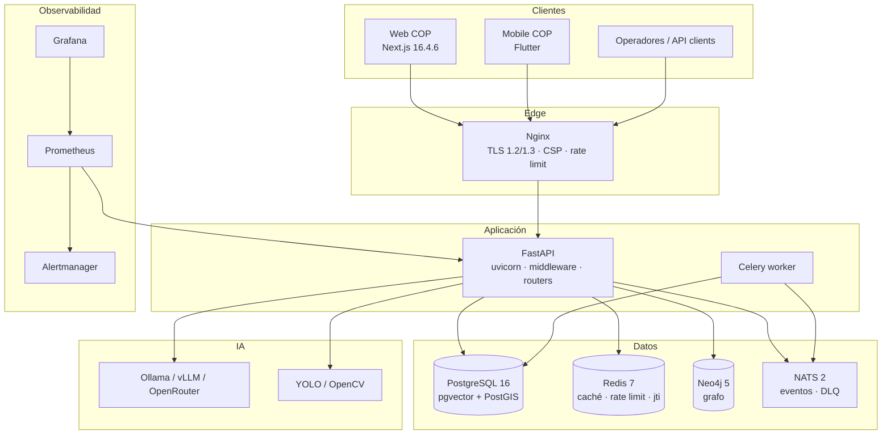
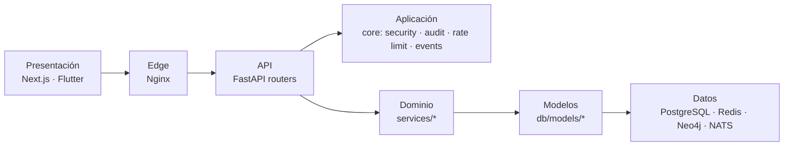
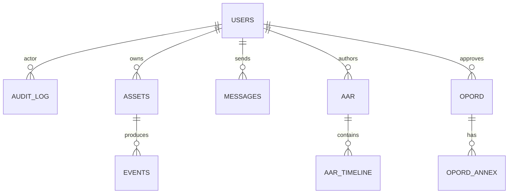
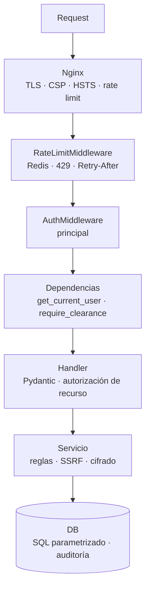
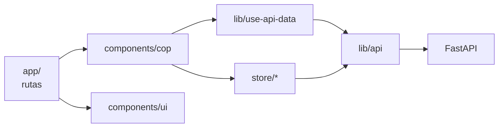
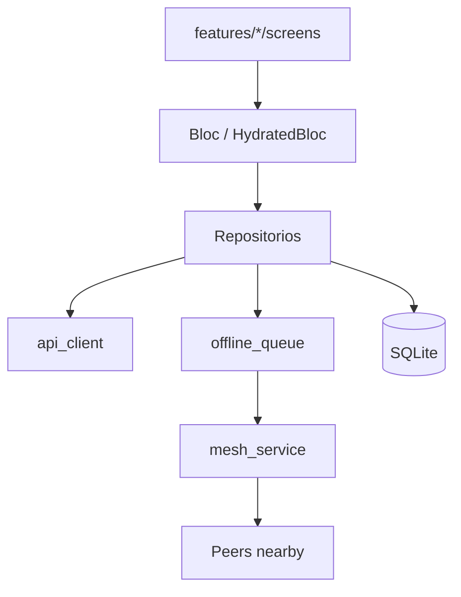
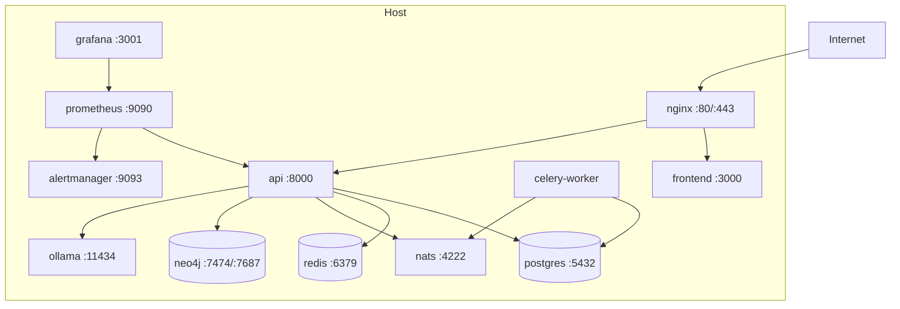

# ARCHITECTURE.md — Arquitectura objetivo y decisiones

**Doc ID:** ARCH-TGT-2026-SND-001
**Proyecto:** SmartNationDefense / SESIS-FEDERATION
**Estado:** `FASE 9 — arquitectura objetivo alineada con el código real`
**Fecha:** 2026-11-21
**Base:** ADR-001..ADR-013 (`docs/architecture/ARCHITECTURE_DECISIONS.md`), código AS-IS (`docs/ARCHITECTURE_CURRENT.md`), mediciones FASE 9.
**Autor:** `@architect`

> Este documento describe **lo que el sistema debe ser** y **por qué**. No sustituye a `ARCHITECTURE_CURRENT.md`, que describe lo que hoy es. Cuando la arquitectura objetivo y el código difieren, se indica explícitamente con `GAP`.

---

## 1. Principios rectores

| # | Principio | Consecuencia práctica |
| ---: | :--- | :--- |
| P-01 | **Modular monolith primero** | Un despliegue, módulos con fronteras claras, sin microservicios prematuros (ADR-001). |
| P-02 | **Seguridad por defecto** | Fail-closed en cifrado, clearance y validación; fail-open sólo donde se decide y se documenta (rate limit). |
| P-03 | **Verdad operativa** | Toda capacidad debe ser observable y verificable; si no se ejecuta, no se documenta como implementada. |
| P-04 | **Contratos explícitos** | OpenAPI versionado, Pydantic estricto, migraciones Alembic, sin `dict` sin esquema en fronteras externas. |
| P-05 | **Defensa en profundidad** | Nginx + middleware + dependencia + handler + DB. Ningún control único es suficiente. |
| P-06 | **Datos clasificados con ciclo de vida** | Nivel, etiqueta, auditoría y borrado; no sólo un campo `classification`. |
| P-07 | **UI de alta densidad, no "AI-slop"** | Tokens, jerarquía, estados completos, 375/768/1440, WCAG AA. |
| P-08 | **Offline-first real** | El móvil debe operar sin red; una cola en memoria no es offline-first. |
| P-09 | **Evolución por ADR** | Todo cambio estructural se registra con alternativas y consecuencias. |
| P-10 | **Honestidad documental** | Las cifras se reproducen; lo no probado se marca. |

---

## 2. Vista C4 (nivel contenedor)



### 2.1 Fronteras

| Frontera | Entra | Sale | Control |
| :--- | :--- | :--- | :--- |
| Internet → Nginx | HTTPS | HTTP interno | TLS, CSP, rate limit, HSTS |
| Nginx → API | HTTP | JSON | Red Docker interna |
| API → DB | SQL parametrizado | Datos | Credenciales por entorno |
| API → Redis | Comandos | Estado | Contraseña opcional según despliegue |
| API → NATS | Publicaciones | Eventos | Credenciales |
| API → Internet (OSINT) | HTTPS | Contenido | SSRF pinning |
| API → LLM | HTTP | Texto | Timeout, fallback |
| Web → API | JSON | JSON | JWT en cabecera |
| Móvil → API | JSON | JSON | JWT + secure storage |

---

## 3. Capas y responsabilidades



| Capa | Responsabilidad | Regla de dependencia |
| :--- | :--- | :--- |
| Presentación | Render, estado, accesibilidad | No conoce SQL ni modelos |
| Edge | TLS, cabeceras, límites | No conoce dominio |
| API | Validación, auth, serialización, códigos HTTP | No contiene lógica de negocio pesada |
| Aplicación | Seguridad transversal, auditoría, eventos, métricas | No conoce routers concretos |
| Dominio | Reglas de negocio, algoritmos, integraciones | No conoce HTTP |
| Datos | Persistencia, migraciones, índices | No conoce HTTP ni UI |

### 3.1 Deuda de capas actual

| GAP | Descripción | Objetivo |
| :--- | :--- | :--- |
| GAP-L1 | Routers v2 contienen lógica de negocio y SQL directo | Extraer a `services/` |
| GAP-L2 | Servicios devuelven `dict` sin esquema | Añadir `response_model` Pydantic |
| GAP-L3 | Servicios en memoria (AAR, reports, messaging) | Persistir en PostgreSQL |
| GAP-L4 | Dos escalas de clasificación | Fuente única en `core/classification.py` |

---

## 4. Módulos y fronteras

| Módulo | Responsabilidad | API | Servicio | Estado objetivo |
| :--- | :--- | :--- | :--- | :--- |
| `core` | Seguridad, auditoría, eventos, métricas | — | — | Estable |
| `auth` | Login, refresh, logout, registro | `/api/v1/auth` | `core/security` | Estable |
| `c2` | Alertas, activos, eventos, PIR, productos | `/api/v1/c2`, `/api/v2/c2` | varios | Completar persistencia |
| `intel` | Inteligencia, feeds, informes | `/api/v1/intel`, `/api/v1/c2` | `services/intel` | **Montar** |
| `osint` | Casos, entidades, jobs, grafo | `/api/v1/osint` | `services/osint` | **Montar** |
| `satellite` | IMINT, cambio, análisis | `/api/v1/satellite` | `services/satellite` | **Montar** |
| `tactical` | OPORD, COA, BDA, fires, PSYOPS | `/api/v1/tactical` | `services/tactical` | Estable |
| `agents` | Mesh, sensores, wearable, stego | `/api/v1/agents` | `services/agents` | **Montar** |
| `planning` | OPORD enriquecido | `/api/v1/planning` | `services/planning` | Estable |
| `logistics` | Suministros, personal, medevac | `/api/v1/logistics`, `/api/v2/logistics` | `services/logistics` | Unificar |
| `messaging` | Mensajería táctica | `/api/v1/messaging` | `services/messaging` | Persistir |
| `aar` | After Action Review | `/api/v1/aar` | `services/aar` | Persistir |
| `reports` | SITREP y reportes | `/api/v1/reports` | `services/reports` | Persistir |
| `fusion` | JDL L0-L4 | `/api/v1/fusion`, `/api/v3` | `services/fusion` | Estable (heurístico) |
| `prediction` | Kalman, patrones | `/api/v1/prediction` | `services/prediction` | Estable |
| `terrain` | Elevación, análisis | `/api/v1/terrain` | `services/terrain` | Estable |
| `mapping` | Mapa táctico | `/api/v1/map` | `services/mapping` | Estable |
| `voice` | Comandos de voz | `/api/v1/voice` | `services/voice` | Estable |
| `maven` | Visión + fusión | `/api/v3` | `services/vision` | Experimental |
| `coa` | Cursos de acción | `/api/v3/coa` | `services/tactical/coa_engine` | Estable |
| `ml` | Anomalías, correlación, briefing | — | usado por servicios | Experimental |
| `observability` | Métricas, dashboards, alertas | `/metrics` | — | Estable en código |

---

## 5. Decisiones arquitectónicas (ADR-001..013)

### 5.1 Tabla resumen

| ADR | Decisión | Estado | Consecuencia principal |
| :--- | :--- | :--- | :--- |
| ADR-001 | Modular monolith vs microservicios | Aceptada | Un despliegue, menor complejidad operativa |
| ADR-002 | Capas presentación/API/aplicación/dominio/datos | Aceptada | Dependencias unidireccionales |
| ADR-003 | User unificado + schemas por dominio | Aceptada | Una tabla `users`, sin colisiones |
| ADR-004 | Auth consolidado | Aceptada | Un router de auth, tokens homogéneos |
| ADR-005 | SSRF IP pinning | Aceptada | Bloqueo de rebinding |
| ADR-006 | Clearance enforcement v1 | Aceptada | 141 rutas, 0 gaps |
| ADR-007 | Alembic como fuente de esquema | Aceptada | Legacy archivado |
| ADR-008 | Infra hardening (SSL + Fernet) | Aceptada | TLS local y cifrado de campos |
| ADR-009 | NATS DLQ + idempotencia | Aceptada | Entrega al menos una vez controlada |
| ADR-010 | Reducción de leaks de clearance | Aceptada | Router-level + handler-level |
| ADR-011 | MVP hardening | Aceptada | Fail-closed, headers, healthz |
| ADR-012 | Security hardening FASE 3 | Aceptada | SSRF, crypto honesto, persistencia |
| ADR-013 | Regeneración documental | Aceptada | Este paquete de documentos |

### 5.2 ADR-001 — Modular monolith

**Contexto:** el repositorio contiene 266 archivos en un solo backend, con 17 subpaquetes de servicios y una sola base de datos. Los intentos de describirlo como microservicios no tienen respaldo en el código.

**Decisión:** monolito modular, con fronteras de módulo y despliegue único.

**Alternativas:**

| Alternativa | Ventaja | Coste | Veredicto |
| :--- | :--- | :--- | :--- |
| Microservicios | Escalado independiente | Complejidad operativa, transacciones distribuidas, 3 auth | Rechazada |
| Monolito modular | Simplicidad, transacciones, un deploy | Escalado grueso | **Elegida** |
| Serverless | Elasticidad | Cold start, estado, DB | Rechazada |

**Consecuencia:** el escalado es horizontal del proceso completo. Si un módulo necesita escalar distinto, se extrae con un ADR nuevo.

### 5.3 ADR-003 — User unificado

**Contexto:** tres modelos `User` colisionaban en la tabla `users`.

**Decisión:** una entidad `User` en `persistence.py`; `IntelUserSchema` y `OsintUserSchema` son vistas/esquemas, no tablas.

**Consecuencia:** una sola fuente de identidad. Los dominios añaden atributos en tablas satélite si los necesitan, no duplican credenciales.

### 5.4 ADR-005 — SSRF IP pinning

**Contexto:** la validación de URL y la conexión ocurrían en momentos distintos (TOCTOU).

**Decisión:** resolver una vez, validar todas las IPs, fijar `socket.getaddrinfo` durante la petición y verificar el peer.

**Consecuencia:** el rebinding de DNS no puede cambiar el destino. Coste: una resolución extra y disciplina para no usar `httpx` fuera del wrapper.

### 5.5 ADR-010 — Clearance en dos niveles

**Contexto:** había 49 rutas v1 sólo autenticadas y 11 v3 sin clearance.

**Decisión:** mínimo `RESTRICTED` a nivel de router (`_CLEARANCE_DEPS`) y niveles específicos en handlers (`require_clearance("CONFIDENTIAL")`, etc.).

**Consecuencia:** defensa en profundidad. Un handler nuevo hereda el mínimo. El test de introspección impide regresiones en v1/v3.

**GAP:** no hay matriz equivalente para v2. Objetivo: extender `test_v1_clearance_matrix.py` a v2.

### 5.6 ADR-013 — Regeneración documental

**Contexto:** 12 contradicciones verificadas entre documentos y código.

**Decisión:** regenerar 8 documentos desde la realidad, con cifras reproducibles y marcas de verificación.

**Consecuencia:** la documentación deja de ser marketing y pasa a ser evidencia. Los documentos se actualizan por fase.

---

## 6. Contratos de API

### 6.1 Política

| Regla | Aplicación |
| :--- | :--- |
| Fuente de verdad | `backend/contracts/openapi.json` generado desde `app.main.app` |
| Versionado | Prefijos `/api/v1`, `/api/v2`, `/api/v3` |
| Compatibilidad | Cambios breaking requieren nueva versión de prefijo |
| Validación | Pydantic 2 con `max_length`, `pattern`, `ge/le` |
| Respuestas | `response_model` cuando el tipo es estable |
| Errores | JSON `{"detail": ...}` con código HTTP correcto |
| Paginación | Objetivo: `limit`/`offset` uniforme (GAP actual) |
| Idempotencia | `Idempotency-Key` en operaciones de escritura (objetivo) |
| Documentación | `/docs` en dev; deshabilitar en prod |

### 6.2 Frontera de autenticación

```text
POST /api/v1/auth/login     → access + refresh
POST /api/v1/auth/refresh   → rotación
POST /api/v1/auth/logout    → revocación
GET  /api/v1/auth/me        → identidad
POST /api/v1/auth/register  → alta (inactiva)
```

Reglas:

- El access token nunca se usa como refresh.
- El ticket MFA nunca se usa como access.
- El logout revoca `jti` en Redis.
- El refresh usado se revoca antes de emitir el nuevo.

### 6.3 Frontera de clasificación

| Nivel | Orden | Uso típico |
| :--- | ---: | :--- |
| `OPEN` | 0 | Datos públicos |
| `RESTRICTED` | 1 | Mínimo para casi todo |
| `CONFIDENTIAL` | 2 | Inteligencia táctica |
| `SECRET` | 3 | Operaciones |
| `TOP_SECRET` | 4 | Acceso excepcional |

Regla: un usuario con nivel N puede leer N y menores; nunca mayores. La comprobación se hace en servidor, siempre.

---

## 7. Modelo de datos objetivo

### 7.1 Entidades núcleo



| Entidad | Clave | Campos obligatorios | Índices |
| :--- | :--- | :--- | :--- |
| `users` | `id` | `username` único, `email` único, `hashed_password`, `role`, `classification_level`, `is_active` | `username`, `email` |
| `audit_log` | `id` | `ts`, `actor`, `action`, `resource_type`, `resource_id`, `prev_hash`, `row_hash` | `ts`, `actor`, `(resource_type, resource_id)` |
| `assets` | `id` | `kind`, `current_status`, `classification_level` | `kind`, `current_status` |
| `events` | `event_id` | `event_type`, `asset_id`, `ts`, `classification_level`, `payload` | `(asset_id, ts)`, `event_type` |
| `sensors` | `sensor_id` | tipo, estado, posición | `sensor_id` |
| `alerts` | `id` | severidad, estado, clasificación | `(status, severity)` |
| `messages` | `id` | remitente, destinatarios, clasificación, TTL | `(thread_id, created_at)` |
| `aar` | `id` | misión, autor, clasificación | `mission_id` |
| `opord` | `id` | operación, clasificación, estado | `(status, classification)` |

### 7.2 Reglas de datos

1. Toda tabla con clasificación tiene `classification_level` con `CHECK` de valores.
2. Toda escritura sensible genera `audit_log`.
3. Los campos cifrados usan `EncryptedField` fail-closed (sin `AES_KEY`, error).
4. Las migraciones son la única vía de cambio de esquema.
5. Los borrados son lógicos (`is_active`, `deleted_at`) cuando hay requisito de auditoría.
6. Las fechas son `TIMESTAMPTZ` en UTC.

### 7.3 GAP de datos

| GAP | Actual | Objetivo |
| :--- | :--- | :--- |
| Persistencia | AAR/reports/messaging en memoria | Tablas + repositorios |
| Paginación | Listados completos | `limit`/`offset` + total |
| Índices | Declarados, no medidos | Medir con `EXPLAIN ANALYZE` |
| Borrado | No uniforme | Política de retención |
| Cifrado | Campos puntuales | Inventario de campos sensibles |

---

## 8. Arquitectura de seguridad

### 8.1 Capas de control



### 8.2 Controles obligatorios por endpoint

| Tipo de endpoint | Controles mínimos |
| :--- | :--- |
| Público | Validación, rate limit, sin datos sensibles |
| Autenticado | JWT válido, tipo correcto, `jti` no revocado |
| Clasificado | Clearance ≥ nivel, auditoría de acceso |
| Escritura | Validación estricta, autorización de recurso, auditoría |
| Integración externa | SSRF, timeout, límite de tamaño, validación de respuesta |
| Upload | Tipo, tamaño, antivirus, almacenamiento aislado, URL firmada con caducidad |

### 8.3 Amenazas y controles

| Amenaza | Control | Estado objetivo |
| :--- | :--- | :--- |
| Fuerza bruta | Rate limit + lockout distribuido | Mantener |
| Confusión de tokens | `expected_type` | Mantener |
| IDOR | Autorización por recurso | **Reforzar** (falta revisión sistemática) |
| SSRF | IP pinning + peer check | Mantener |
| XSS | CSP + React escaping | Mantener |
| SQLi | SQLAlchemy parametrizado | Mantener |
| CSRF | JWT en cabecera, no cookie | Mantener |
| Upload malicioso | Router no montado | Diseñar antes de montar |
| Prompt injection | Sin control | **Añadir** validación/salida |
| Cadena de suministro | Pins | **Añadir** auditoría |

### 8.4 Secretos

| Secreto | Almacenamiento actual | Objetivo |
| :--- | :--- | :--- |
| `SECRET_KEY` | Env | Env/secret manager |
| `MFA_ENCRYPTION_KEY` | Env (64 hex) | Secret manager |
| `FERNET_KEY` | Fichero | Secret manager/KMS |
| `AES_KEY` | Env | Secret manager |
| Credenciales DB/Redis/NATS/Neo4j | Env | Secret manager |
| Claves de APIs externas | Env | Secret manager |

Regla: ningún secreto en Git. `.env.example` sólo contiene placeholders `CHANGE_ME_*`.

---

## 9. Sistema de diseño (UI)

### 9.1 Dirección visual

Táctica, oscura, alta densidad, sin adornos. La interfaz debe sentirse como una herramienta operativa: jerarquía clara, datos legibles, estados evidentes.

### 9.2 Tokens vigentes

| Token | Valor | Uso |
| :--- | :--- | :--- |
| `--color-bg-primary` | `#060a12` | Fondo raíz |
| `--color-bg-secondary` | `#0b1220` | Superficie |
| `--color-bg-tertiary` | `#152136` | Elevación |
| `--color-border` | `#1c2942` | Borde sutil |
| `--color-border-strong` | `#263854` | Borde activo |
| `--color-text-primary` | `#e8eefc` | Texto principal |
| `--color-text-secondary` | `#93a4c2` | Texto secundario |
| `--color-text-faint` | `#778bab` | Texto terciario |
| `--color-accent` | `#22d3ee` | Acento/acción |
| `--color-success` | `#34d399` | Éxito |
| `--color-warning` | `#fbbf24` | Advertencia |
| `--color-danger` | `#f87171` | Error/peligro |
| `--color-info` | `#60a5fa` | Información |

### 9.3 Tipografía y ritmo

| Elemento | Regla |
| :--- | :--- |
| Sans | Inter (o system-ui como fallback) |
| Mono | JetBrains Mono / ui-monospace |
| Escala | 8 px |
| Radios | 6 / 10 / 14 px |
| Densidad | Tablas compactas, paneles con padding 16–24 px |
| Contraste | WCAG AA mínimo |

### 9.4 Estados obligatorios

Toda vista con datos remotos debe implementar:

1. **Loading:** skeleton con la forma del contenido, no spinner genérico.
2. **Empty:** mensaje claro + CTA cuando aplique.
3. **Error:** mensaje accionable + botón de reintento.
4. **Success:** datos + timestamp de actualización.
5. **Stale:** indicador cuando el polling falla pero hay datos previos.

### 9.5 Responsive

| Breakpoint | Objetivo |
| :--- | :--- |
| 375 px | Una columna, navegación compacta, tablas con scroll |
| 768 px | Dos columnas, paneles plegables |
| 1440 px | Multi-panel, mapa + inteligencia + logística simultáneos |

### 9.6 Reglas anti "AI-slop"

- No gradientes decorativos sin función.
- No sombras difusas grandes; elevación por borde y superficie.
- No iconos de relleno; cada icono comunica.
- No texto genérico ("Welcome to your dashboard").
- No animaciones que retrasen la lectura.
- No colores de acento múltiples compitiendo.

---

## 10. Arquitectura frontend



| Decisión | Implementación | Motivo |
| :--- | :--- | :--- |
| App Router | Next.js 16.4.6 + React 19 | Rutas y layouts |
| Client components | `"use client"` | Estado e interactividad |
| Carga dinámica | `dynamic(..., { ssr: false })` | Leaflet/Recharts requieren `window` |
| Estado | Zustand | Simple, sin boilerplate |
| Datos | `useApiData` | Loading/error/reload uniformes |
| Estilos | Tailwind + variables CSS | Tokens y utilidades |
| Tipos | `cop-types.ts`, `maven-types.ts` | Contrato explícito |

### 10.1 GAP frontend

| GAP | Objetivo |
| :--- | :--- |
| Tests de componentes | Vitest/Testing Library |
| Tests E2E | Playwright |
| Contrato generado | Tipos desde OpenAPI |
| Manejo de token | Evaluar memoria vs almacenamiento persistente |
| Accesibilidad | Auditoría axe |
| i18n | Extraer cadenas |

---

## 11. Arquitectura móvil



| Decisión | Estado actual | Objetivo |
| :--- | :--- | :--- |
| Estado | Bloc + Hydrated | Mantener |
| Almacenamiento seguro | `flutter_secure_storage` | Mantener |
| DB local | `sqflite` declarado | Implementar repositorios |
| Cola offline | `core/storage/offline_queue.dart` implementado (138 LOC) | Persistencia y reintentos probados |
| Mesh | `nearby_connections` + 11 tests de protocolo | Probar en dispositivos |
| Tema | `AppTheme.militaryDark` con `CardTheme` | Mantener |
| Duress | Pantalla existe | Definir comportamiento y borrado seguro |

### 11.1 Requisitos de offline-first

1. Toda escritura se persiste localmente antes de intentar red.
2. La cola tiene orden, reintentos y TTL.
3. El conflicto se resuelve por timestamp + autoridad.
4. El usuario ve estado (`pendiente`, `enviado`, `fallido`).
5. El borrado por duress elimina claves y cola.
6. La sincronización es idempotente (usa el mismo `message_id`).

---

## 12. Arquitectura de despliegue

### 12.1 Topología



### 12.2 Entornos

| Entorno | Objetivo | Configuración |
| :--- | :--- | :--- |
| Desarrollo | Iteración | `.env` local, `DEBUG=true`, docs habilitados |
| Staging | Validación | Secretos reales, TLS, datos sintéticos |
| Producción | Operación | `ENVIRONMENT=production`, validadores activos, docs deshabilitados |

### 12.3 Reglas de despliegue

1. `production` no arranca con secretos débiles (validador).
2. Migraciones se ejecutan antes de la API (`alembic upgrade head`).
3. El healthcheck de API usa `/api/v1/health`.
4. Nginx expone `/healthz` para probes.
5. Prometheus scrapea `/metrics` en red interna.
6. Grafana y Alertmanager no se exponen públicamente.
7. Los volúmenes de datos son persistentes y respaldables.
8. Los secretos se inyectan, no se hornean en la imagen.

### 12.4 GAP de despliegue

| GAP | Riesgo | Objetivo |
| :--- | :--- | :--- |
| Sin validación Docker | Alto | Ejecutar compose en CI/host |
| Sin backups | Alto | Política + prueba de restore |
| Sin HA | Medio | Réplicas + balanceo |
| Sin mTLS | Medio | Service mesh o TLS mutuo |
| Sin SBOM | Medio | Generar en CI |

---

## 13. Observabilidad

### 13.1 Señales

| Señal | Fuente | Uso |
| :--- | :--- | :--- |
| `sesis_http_requests_total` | Middleware | Tráfico y errores |
| `sesis_http_request_duration_seconds` | Middleware | Latencia p95 |
| `sesis_http_errors_total` | Middleware | 4xx/5xx |
| `sesis_module_up` | Arranque | Disponibilidad declarada |
| `sesis_security_events_total` | `require_clearance`, lockout | Seguridad |
| `sesis_app_info` | Arranque | Build |

### 13.2 Reglas de alerta

| Alerta | Condición | Acción |
| :--- | :--- | :--- |
| `SesisApiDown` | `up == 0` | Paginar |
| `SesisModuleDown` | `sesis_module_up == 0` | Investigar |
| `SesisHighLatencyP95` | p95 > 1,5 s | Revisar DB/LLM |
| `SesisHighServerErrorRate` | 5xx ratio alto | Revisar logs |
| `SesisClearanceDenialsSpike` | 403 > 50/10m | Posible ataque |
| `SesisAuthFailureSpike` | 401 > 100/10m | Posible fuerza bruta |
| `SesisBruteForceLockout` | lockout > 0 | Bloquear origen |
| `SesisClearanceDeniedEvent` | > 20/10m | Revisar permisos |

### 13.3 GAP

- `sesis_module_up` es un snapshot de arranque, no un healthcheck activo. Objetivo: actualizarlo con probes reales.
- No hay trazas distribuidas (OpenTelemetry).
- No hay logs estructurados centralizados.
- No hay SLOs definidos.

---

## 14. Estrategia de pruebas

| Nivel | Herramienta | Cobertura objetivo |
| :--- | :--- | :--- |
| Unitario | pytest | Servicios y core |
| Integración | pytest + SQLite/PostgreSQL | Routers y DB |
| Contrato | pytest + OpenAPI | Drift |
| Seguridad | pytest | SSRF, auth, clearance, auditoría |
| E2E | pytest/Playwright | Flujo completo |
| Frontend | Vitest/Testing Library | Componentes |
| Móvil | flutter test | 11 tests de protocolo; pantallas y cola pendientes |
| Carga | k6/Locust | Latencia y throughput |
| Infra | docker compose + smoke | Arranque real |

Regla: ningún AC se marca `[x]` sin un test o una comprobación ejecutable.

---

## 15. Roadmap de evolución

| Fase | Objetivo | Criterio de salida |
| :--- | :--- | :--- |
| FASE 7 | Móvil compilable y offline real | **COMPLETA**: `flutter analyze` 0, `flutter test` 11 passed |
| FASE 9 | Documentación verdadera | 8 docs regenerados + coherencia |
| FASE 10 (propuesta) | Montar OSINT/Intel/Satellite | Rutas reales + tests |
| FASE 11 (propuesta) | Persistencia de dominios en memoria | Tablas + repositorios |
| FASE 12 (propuesta) | Cobertura y cadena de suministro | `pytest-cov` (88% seguridad), `pip-audit` 0 con allowlist |
| FASE 13 (propuesta) | Validación Docker/observabilidad | Smoke test en host real |
| FASE 14 | Next 16.4.6 + React 19 | **VERIFICADA**: `tsc` 0, `next build` OK, 4 rutas, 0 vulnerabilidades prod |

> Las fases 10–14 son propuestas, no compromisos. Requieren decisión de producto y un ADR si cambian fronteras.

---

## 16. Decisiones pendientes (ADR futuros)

| Tema | Pregunta | Opciones |
| :--- | :--- | :--- |
| OSINT API | ¿Montar o retirar? | Montar routers reales / despublicar |
| Persistencia | ¿PostgreSQL para todo? | Postgres / híbrido con Redis |
| Cifrado | ¿KMS/HSM? | Cloud KMS / Vault / software |
| Auditoría | ¿WORM? | S3 Object Lock / ledger / DB append-only |
| Móvil offline | **Decidido**: Sqflite + `offline_queue`; faltan repositorios de pantalla | Mantener Sqflite |
| LLM | ¿Local o proveedor? | Ollama / vLLM / OpenRouter |
| Multi-tenant | ¿Activar? | Single-tenant / tenant por esquema |
| Observabilidad | ¿OpenTelemetry? | Sí / mantener Prometheus |
| Frontend | Next 16.4.6 + React 19 | **VERIFICADO** en copia con Node 20.18 |

Cada uno requiere: contexto, alternativas, decisión, consecuencias y reversibilidad.

---

## 17. Conclusión

La arquitectura objetivo es **conservadora y verificable**: monolito modular, seguridad en capas, contratos explícitos, datos persistentes, observabilidad real y UI de alta densidad. No requiere reescritura; requiere completar lo que ya está empezado y dejar de documentar lo que no se ejecuta.

Las tres prioridades arquitectónicas son:

1. **Cerrar la brecha entre API y dominio** (stubs y servicios huérfanos).
2. **Probar el despliegue real** (Docker, migraciones, métricas).
3. **Cerrar SEC-FIX-007/008**; el build de Next 16.4.6 ya está verificado.

El móvil (0 errores, 11 tests), el build Next 16 (0 errores, 4 rutas, 0 vulnerabilidades prod) y la cobertura de las 6 suites de seguridad (88%) están verificados; el backend completo no está medido al 80% (~73%). Con las tres prioridades anteriores, el resto es deuda gestionable.
