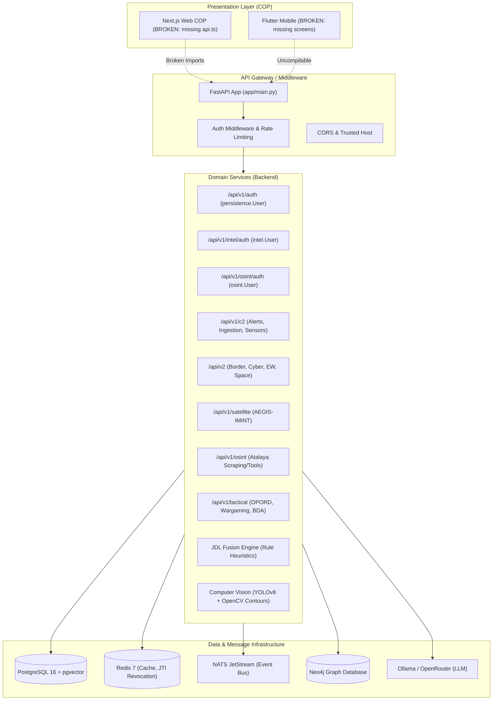
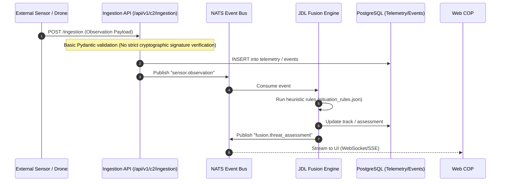
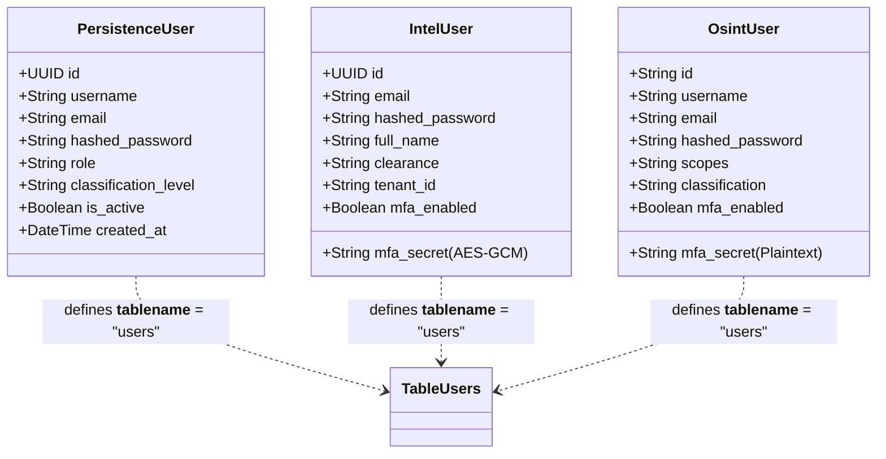
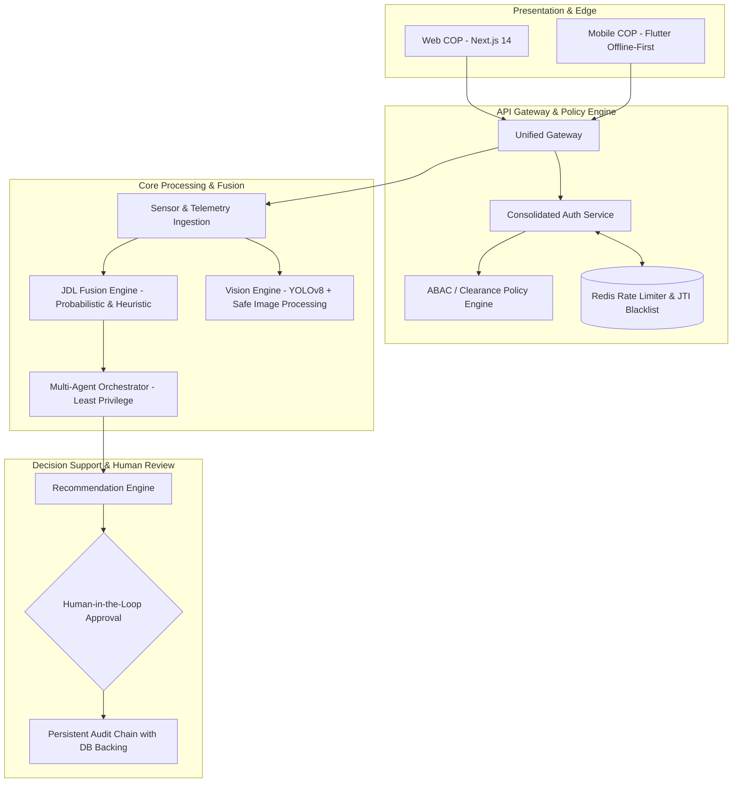

# ARCHITECTURE_CURRENT.md — As-Is System Architecture & Defect Mapping

**Document ID:** ARCH-2026-SND-001  
**Date:** 2026-09-25  
**System:** SmartNationDefense / SESIS-FEDERATION  
**Status:** CURRENT STATE (AS-IS AUDIT)  

---

## 1. Architectural Topology Overview

The system is designed as a hybrid microservice and modular monolith federation combining multiple C2/intelligence modules behind a unified FastAPI gateway, with Next.js (Web COP) and Flutter (Mobile COP) frontends.

---

## 2. Ingestion & Data Flow Analysis

### 2.1 Sensor Ingestion Path

**Flaws in current flow:**
1. **Sensor Attribution & Signing:** Sensor inputs are accepted without cryptographic signature or provenance binding. A compromised network path can inject spoofed radar or drone tracks.
2. **Synchronous DB Blocking:** Some ingestion endpoints execute synchronous or non-batched database operations, creating bottlenecks under high telemetry ingest rates.
3. **Missing Backpressure:** NATS message consumption lacks dead-letter queue (DLQ) mechanics and idempotency verification.

---

## 3. Database Schema Overlap & Collision Analysis

A primary architectural flaw is the presence of **three colliding User models** in separate modules targeting the identical table name:

### Consequences of Collision:
- Alembic migrations fail or produce conflicting SQL when scanning `metadata`.
- Sessions referencing `User` may query incomplete schemas depending on which submodule was imported first.
- Security privileges, clearances, and MFA secrets are fragmented across three non-interoperable auth routers.

---

## 4. Subsystem Assessment & Divergence Matrix

| Subsystem | Documented Claim | Code Reality | Technical Gap |
|---|---|---|---|
| **Identity & Access** | "MFA-secure Zero-Trust ABAC" | 3 competing auth systems; plaintext MFA secrets in OSINT; in-memory lockout | High: Lack of unified identity, insecure secret storage |
| **Audit Trail** | "Tamper-proof SHA-256 Chain" | In-memory `AuditChain`; resets on restart; invalid import of `app.db.models.audit` | High: Non-persistent audit; untracked tampering |
| **Sensor Fusion** | "Full JDL Levels 0–4 Engine" | Rule-based string matching against `situation_rules.json` | Medium: No probabilistic tracking (Kalman, particle filtering) |
| **Computer Vision** | "Military Vehicle/Threat Detection" | Standard YOLOv8 with invalid classes (100-103); per-frame background subtractor recreation | Medium: Ineffective detection of custom military assets |
| **Web COP** | "Unified Real-Time Dashboard" | Next.js app broken due to missing `lib/api.ts` | Critical: Will not compile or render |
| **Mobile Client** | "Offline-first Secure Mesh Node" | Flutter app missing entire `features/` directory | Critical: Will not compile or launch |
| **Quantum Cryptography**| "Quantum-safe Kyber & Dilithium" | Fernet fallback mislabeled as AES-256-GCM; uninstalled `pqcrypto` stubs | High: Deceptive labeling of symmetric crypto |
| **Simulation / Wargaming** | "Algorithmic COA Generator" | Predefined template expansion; no integration with operational guardrails | Medium: Potential confusion between simulation and operation |

---

## 5. Target Clean Architecture Evolution

To address the audit findings, the architecture must transition from fragmented stubs to a clean layered model:

