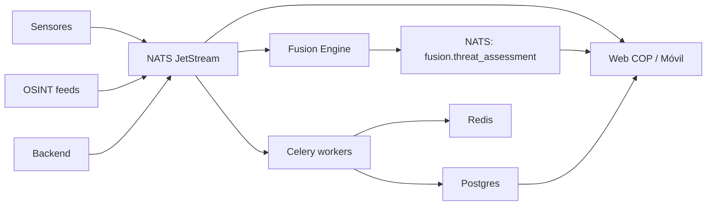
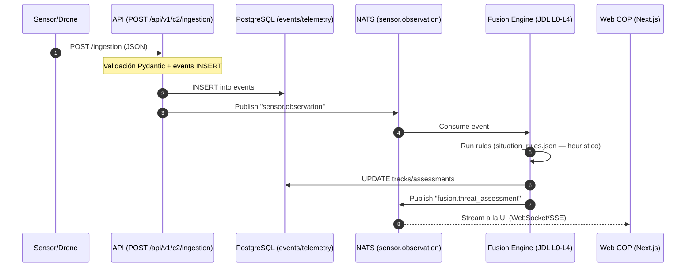

# DATA_FLOW.md — Flujos de Datos y Eventos (FASE 1 — ARCHITECTURE TARGET)

**Doc ID:** ARCH-DF-001 | **Estado:** FASE 1 — TARGET (diseño real AS-IS)
**Fecha:** 21-11-2026

> **Regla:** Todos los flujos de datos son reales (FASE 0 AS-IS, arquitectura target). Diagramas Mermaid.

---

## 1. Flujo Principal: Ingestión de Datos (Real)

```mermaid
flowchart TD
    S[Sensores: Satélite Sentinel, Radar, AIS, Satélite, Drones] --> I[Ingestion API /api/v1/c2/ingestion]
    I --> DB[(PostgreSQL 16 + pgvector + PostGIS — assets, events, telemetry)]
    I --> NATS[NATS JetStream — sensor.observation + asset.heartbeat]
    NATS --> F[Fusion Engine — JDL L0-L4 heurístico]
    F --> DB
    F --> NATS2[NATS: fusion.threat_assessment]
    NATS2 --> U[Consolas: Web COP (Next.js 14) + Móvil COP (Flutter)]
    SAT[AEGIS-IMINT — Sentinel/PAZ + NDVI + cambio espectral] --> DB
    SAT --> NATS3[NATS: satellite.*]
    NATS3 --> U
```

**Notas (AS-IS verificado FASE 0):**
- Ingestión de telemetry: SQL → events table → NATS sensor.observation (sin provenance ID — OPS-02, sin firmas criptográficas — OPS-02)

---

## 2. Flujo Principal: OSINT & Intel (Real)

```mermaid
flowchart TD
    O[OSINT — Atalaya (12 Scrapers)] --> S[Scrapers: web_fetch, dns_tools, social_tools, document_tools, cert_tools, archive_tools, whois_tools]
    O --> N[NATS: osint.event.*]
    N --> F[OSINT Agent Coordinator — 8+ fuentes (RSS, NewsAPI, GDELT, DuckDuckGo, Seguridad, Finint, Cybint, IMINT)]
    F --> DB[(Postgres — osint tables)]
    F --> N2[NATS: osint.*]
    N2 --> U[Consolas: Web COP + Móvil COP]
    I[Intel — Global-Intelligence (RAG, LLM, Scenarios)] --> DB
    I --> N3[NATS: intel.threat_assessment]
    N3 --> U
    A[Agents — SpyManager] --> DB
    A --> N4[NATS: agents.*]
    N4 --> U
```

---

## 3. Flujo Principal:Tactical (Real)

```mermaid
flowchart TD
    B[Tactical — OPORD/COA/BDA/PSYOPS] --> DB[(Postgres — tactical tables, opord_enhanced)]
    B --> S[Tactical services (coa_engine, joint_fires, bda, psyops, wargaming)]
    S --> N[NATS: tactical.*]
    N --> U[Consolas: Web COP + Móvil COP]
    V[Tactical: Maven — CV + CV Multisensor] --> DB
    V --> S2[Services: vision + mapping]
    S2 --> N2[NATS: maven.*]
    N2 --> U
```

---

## 4. Flujo de Validación (Real)

```mermaid
flowchart TD
    U[Consolas/API: login/auth] --> P[Borrar: passwords hashed bcrypt (passlib + bcrypt 4.0.1)]
    P --> J[JWT: HS256 (access, refresh, mfa_challenge)]
    J --> V[Validate_all.py: pytest + invariants]
    V --> R[reports/validation.json + GitHub Issues Tracking]
    V --> C[Setup: build-workspace]
    C --> D[Dev: npm install + type-check + build + E2E: 20-min window]
    D --> D2[npm run build + docker compose up --build]
    D2 --> E2E[E2E scripts playwright, e2e/tests/*]
    E2E --> F[Far ID: go variant]
    F --> G[Launch: nginx → api → frontend]
    G --> H[Gression: GH Actions + drift detection]
```

---

## 5. Flujo de Eventos: NATS JetStream (Real)

```mermaid
flowchart TD
    S1[Sensores/Infrareal: Satélite + Radar] --> N1[NATS: sensor.observation]
    S2[OSINT/Intel: RSS/NewsAPI/GDELT + scraping] --> N2[NATS: osint.*]
    S3[Satellite: Sentinel/PAZ, NDVI change detection] --> N3[NATS: satellite.*]
    N1 --> F[Fusion Engine]
    N2 --> F
    N3 --> F
    F --> N4[NATS: fusion.threat_assessment]
    N4 --> U[Web COP + Móvil COP + Mobile Device (Pull)]
    N4 --> W[Workers: Celery (celery_app)]
    W --> DB[(PostgreSQL — osint + persistence + maven tables)]
    N4 --> M[Móvil: Flutter COP — poll via api_client]
    M --> DB
    N4 --> Q[Queue: Celery jobs — jobs.py, messaging]
```

**Notas (AS-IS):**
- Messages en NATS a consumidores: sin DLQ (FASE 3), sin idempotency (FASE 3)
- Fusion Engine consume: verificar implementación en FASE 2 (`event_bus.consume` en core/events.py)

---

## 6. Flujo: Seguridad & Auditoría (Real)

```mermaid
flowchart TD
    A[Todos — Bearer + request.state.principal] --> R[AuthMiddleware: AuthMiddleware (fail-open) → principal]
    R --> C[clearance enforcement via require_clearance (v2 + v1 ABAC)]
    A --> L[Login osint (Redis brute force)]
    L --> T[Token, rotate blacklist Redis]
    R --> R2[rate_limit: Redis sliding window + api:8000 limiter]
    R --> B[Audit: AuditChain — SHA-256 — memoria + test_persistence]
    R --> R3[SSRF: is_safe_url_async + safe_http_get — TOCTOU — FASE 3]
```

---

## 7. Diagramas Completos (Sintaxis Mermaid)





---

## 8. Notes AS-IS: Funcionalidades Fractadas (FASE 0 — débitos reales)

| Flujo | Status | Problems As-IS | TD |
|---|---|---|---|
| Fusion → COP | PARTIAL | Payloads parciales; consumo de NATS a UI pendiente verificar FASE 2 | TD-002, N-01 |
| OSINT → DB | PARCIAL | Eventos de scraper sin provenance (OPS-02) | TD-002, TD-011 |
| Satélite → COP | PARCIAL | NDVI change detection validada; Ollama analysis experimental | TD-002 |
| OSINT scraper → DB | INTEGRATED | Scraper nativo + integrations wrapper | — |
| Móvil → API | PARCIAL | API v3 (maven) + JWT + mesh protocol — offline primero FASE 7 | — |