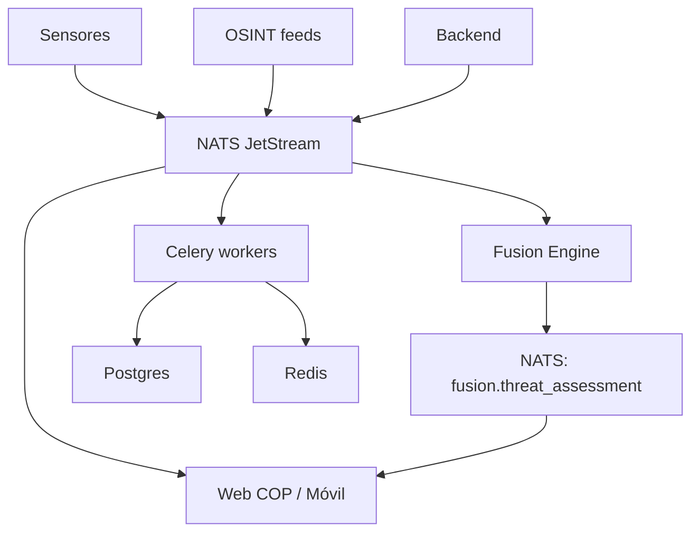

# SYSTEM_OVERVIEW.md — Visión General del Sistema (FASE 1 — ARCHITECTURE TARGET)

**Doc ID:** ARCH-SYS-001 | **Estado:** `ARCHITECTURE TARGET` (diseño de FASE 1)
**Fecha:** 21-11-2026 | **From:** FASE 0 Audit — `docs/audit/REPOSITORY_AUDIT.md` (AS-IS), `docs/audit/ARCHITECTURE_ASSESSMENT.md`

> **Regla:** Archivo de FASE 1 — ARCHITECTURE TARGET (diseño aspiracional). Aspectos AS-IS de FASE 0 nombrados en forma `AS-IS` en lo relevante.

---

## 1. Tipo de Arquitectura: MODULAR MONOLITO (DECISION-ADR-001)

**Justificación (ADR-001, reversa FASE 0):**
- El código real no justifica Microservicios: solo un monolito FastAPI con múltiples stacks funcionales bien definidos.
- TD-001 (3 modelos User collisiones, 3 routers de auth) se RESUELVE con consolidation at the monolith level (unified User via mixins + uniformización de routers en FASE 2), no requiere contar con routing o despliegue por microservicios.
- Deployment eléctrico: un único proceso Python (`uvicorn app.main:app`) con stacks in-process (async: FastAPI + Redis + NATS + Neo4j + PGVector).
- User preference documentado ("MODULAR MONOLITO si código no lo justifica; el user prefiere modular monolith").

**Archivos Conceptuales — ADR-002 (Layout Layers):**
```text
SmartNationDefense/ (repository root)
├── backend/                    # App server (Python FastAPI + Async)
│   ├── app/
│   │   ├── api/                # (Presentation/API layer) — routers por área
│   │   ├── core/               # (Application/Services) — security, audit, crypto, pipeline
│   │   ├── db/                 # (Domain) — models (persistence, intel, osint, ...)
│   │   ├── services/           # (Services) — intel, osint, sat, tactical, fusion, mapping
│   │   ├── agents/             # (Services) — osint, intel, neural
│   │   ├── workers/            # (Background workers) — celery_app
│   │   └── main.py             # (Presentation entrypoint)
├── frontend/                   # (Presentation — Web COP, Next.js 14)
├── mobile/sesis_cop/           # (Presentation — Tactical Mobile COP, Flutter)
├── ml/                         # (Domain — Data science, ML models, Rules)
├── infra/                      # (Infrastructure — nginx, prometheus, grafana, certs)
├── compliance/                 # (Compliance — ENS ALTA, STANAG 4774/4778 matrices)
├── docs/                       # (Docs — audit, architecture, control files)
├── reports/                    # (Validación) — validation.json
├── .factory/                   # (Factory SDD) — SPEC/ARCHITECTURE/TASKS/SECURITY_AUDIT
├── scripts/                    # (Deployment — validate_all.py, seed_data, keys)
└── Makefile, README.md, docker-compose.yml, .env.example
```

---

## 2. Modelo de Capas Arquitectónico

```text
┌─────────────────────────────────────────────────────────────────────┐
│                    PRESENTATION LAYER (Presentation/UI)              │
├─────────────────────────────────────────────────────────────────────┤
│  WEB (Next.js 14)      │  Mobile (Flutter tactical, offline-first)  │
│  [app/page, app/login, │  [core/network/{api_client,mesh_protocol, │
│   app/maven, components/cop] mesh_service], features/*,             │
│   store/* (auth-store, cop-store, maven-store), lib/api.ts]         │
└─────────────────────────────────────────────────────────────────────┘
                              │ HTTPS + JWT (Bearer) + MFA + clearance
                              ▼
┌─────────────────────────────────────────────────────────────────────┐
│                    API LAYER (API/gateway) — FastAPI                 │
├─────────────────────────────────────────────────────────────────────┤
│  nginx (edge) → AuthMiddleware (fail-open) → RateLimitMiddleware     │
│  → FastAPI main.py: routers por área (v1 legacy, v1 modern, v2,      │
│     v3, tactical, osint, sat, intel, agents, policy, media...)      │
└─────────────────────────────────────────────────────────────────────┘
                              │ HTTPS + JWT + clearance + mfa
                              ▼
┌─────────────────────────────────────────────────────────────────────┐
│                    APPLICATION LAYER (Core/Services)                 │
├─────────────────────────────────────────────────────────────────────┤
│  - core/{security (JWT HS256/MFA challenge/refresh), auth_middleware,│
│    rate_limit (Redis sliding window), audit (AuditChain SHA-256),    │
│    classification, crypto (AES), llm_orchestrator, pipeline, events} │
│  - services/*: intel (signing Ed25519, rag, llm), osint (12 agents,  │
│    tools suite, integrations, llm providers), vision (YOLOv8),       │
│    fusion (JDL L0-4 heurístico → experimental), prediction, tactical │
│    (opord, wargaming, joint_fires, bda, psyops), mapping, terrain,   │
│    logistics, voice, planning, compliance, messaging, aar, reports,  │
│    security (UEE), policy                                            │
│  - agents/*: osint (8 scrapers), intel (orchestrator, providers,     │
│    llm), neural helpers                                              │
└─────────────────────────────────────────────────────────────────────┘
                              │ Async I/O + Repos
                              ▼
┌─────────────────────────────────────────────────────────────────────┐
│                    DOMAIN LAYER (Models/DB)                           │
├─────────────────────────────────────────────────────────────────────┤
│  - models/persistence (TODO: consolidated User ADR-001)              │
│  - models/intel (user, reports, interactions, intelligence, geography,│
│    auth, audit)                                                       │
│  - models/osint (user, case, entity, job, intel_records, evidence,   │
│    report, audit_log)                                                │
│  - models/* others (messaging, opord_enhanced, aar)                  │
│  - infra: PostgreSQL 16 + pgvector + PostGIS; Redis 7 (AOF);         │
│    NATS JetStream; Neo4j 5 (graph); Ollama/vllm/OpenRouter           │
└─────────────────────────────────────────────────────────────────────┘
                              │
                              ▼
┌─────────────────────────────────────────────────────────────────────┐
│                    DATA FLOW / EVENT FLOW                             │
│  sensor/telemetry → ingestion API → DB + NATS(sensor.observation) →   │
│  fusion → NATS(fusion.threat_assessment) → COP UI (web+mobile)        │
│  osint scrapers → RSS/NewsAPI/GDELT → DB + events → COP UI            │
│  events → Kafka-equivalent (NATS) → consumers (workers, cop)          │
└─────────────────────────────────────────────────────────────────────┘
```

---

## 3. Stack & Tech Stack (FASE 0-verificado, FASE 2 nuevo)

| Capa | Tecnología | Version / Comentarios |
|---|---|---|
| **Backend** | FastAPI, Python | 0.115.6, uvicorn 0.34.0 |
| **ORM/DB** | SQLAlchemy 2.0.36 + Alembic | asyncpg 0.30.0, PostgreSQL 16 (pgvector + PostGIS) |
| **Redis** | redis 5.2.1 (asyncio) | AOF (docker-compose), TB |
| **NATS** | nats-py 2.9.0 | JetStream (docker-compose) |
| **Neo4j** | neo4j 5.27.0 | services/agents/neo4j_service.py |
| **LLM** | Ollama 0.4.7, httpx 0.28.1, vllm stub, OpenRouter, Anthropic, OpenAI | routers en services/intel/llm + services/osint/llm |
| **CV/ML** | OpenCV 4.10.0.84, numpy 2.2.1, ultralytics 8.3.0, torch 2.5.1 | YOLOv8 (drone_processor, analyst, ml/vision.py) |
| **OSINT** | httpx, beautifulsoup4, lxml, trafilatura, duckduckgo_search | tools suite + integrations |
| **Web Frontend** | Next.js 14.2.35, React 18.2, Tailwind 3.4, Zustand 4.4, Leaflet | 30+ componentes cop/, 3 stores |
| **Móvil** | Flutter (5+ screens real), hydrated_bloc, path_provider, flutter_map, sqflite, google_fonts | 7 screens, mesh protocol |
| **Infra** | nginx:alpine, postgres (pgvector/pg16), redis:7-alpine, nats:2-alpine, neo4j:5-community, prom/prometheus:latest, grafana/grafana:latest, ollama/ollama:latest | docker-compose.yml 11 services |
| **Herramientas** | Makefile, scripts/* (validate_all.py, seed_data.py, generate_keys.py, demo scripts) | |

---

## 4. Mapa de Arquitectura — Stacks por Módulo (AS-IS → TARGET — revisar en FASE 2-5)

| Módulo | Stacks AS-IS | TARGET |
|---|---|---|
| Autenticación (JWT, MFA) | api/auth.py (persistence), api/osint/auth.py (osint), api/intel/auth.py (intel), core/security.py, core/auth_middleware.py | Unified User (TD-001), uniform routers (TD-003), clearance enforcement v1 (N-01) |
| Seguridad (SSRF, crypto) | web_tools.py, crypto_quantum.py, mfa.py | SSRF pinning (FASE 3), crypto honesto (FASE 3), Standard labels |
| Audit | core/audit.py, tests/test_audit_persistence.py | Persistence real (FASE 2-3) |
| DB | persistence.py (3 User), intel/*, osint/*, migrations/legacy, alembic | Unificado (FASE 4) |
| Fusion | services/fusion/jdl_fusion.py (heurístico), services/fusion/engine.py | Probabilístico (FASE 2-3), registro de ADR en TASKS.md |
| Máster Intel | services/intel/* (signing, rag, llm), agents/intel/* (orchestrator, providers) | Robust Pydantic (FASE 2) |
| OSINT | services/osint/* (12 agents, tools, integrations, llm) | Backpressure/DLQ (FASE 2), resilient retries (FASE 3) |
| SAT | services/satellite/* | Detections + NDVI + change detection hardened |
| Tactical/COA | services/tactical/* (opord, coa_engine, joint_fires, bda, psyops) | COA compare + grading (FASE 2) |
| Móvil | Flutter — 7 screens | Offline-mesh hardening (FASE 7) |
| Docs | docs/* real | Regenerar (FASE 9) |

---

## 5. Data Flow — Diagrama (Simplificado, As-IS — AS-IS en FASE 1/2)

```mermaid
flowchart TD
    S[Sensores/Infrareal] --> I[Ingestion API /api/v1/c2/ingestion]
    I --> DB[PostgreSQL 16 + pgvector + PostGIS]
    I --> N[NATS: sensor.observation]
    N --> F[Fusion Engine (JDL L0-L4 heurístico)]
    F --> DB
    F --> N2[NATS: fusion.threat_assessment]
    N2 --> U[Web COP — Next.js 14]
    S --> SAT[AEGIS-IMINT — Sentinel/PAZ, NDVI, cambio espectral]
    O[OSINT — Atalaya — 12 scrapers + integrations] --> DB
    I2[Intel — Global-Intelligence — RAG, LLM,signed events] --> DB
    T[Tactical — OPORD/COA/BDA/PSYOPS] --> U
    M[Móvil — Flutter — COP] --> U
    W[Web COP UI] --> W2[Web COP]
    A[Admin/Regler] --> P[Postgres DBs]
    O --> NATS_L[NATS JetStream]
    DB --> NATS_L[NATS JetStream]
    NATS_L --> W[Web COP UI]
    U --> NATS_L[NATS JetStream]
    W[Web COP] --> NATS_L
    I --> NATS_L[NATS JetStream]
```

---

## 6. Event Flow — Diagrama (Simplificado)



---

## 7. Links Interesantes

- `docs/audit/REPOSITORY_AUDIT.md` — AS-IS inventory (FASE 0)
- `docs/audit/SECURITY_AUDIT.md` — Hallazgos security reales (FASE 0)
- `docs/audit/FEATURE_MATRIX.md` — Matriz de realidad (FASE 0)
- `docs/architecture/ARCHITECTURE_DECISIONS.md` — ADRs decisiónar (FASE 1)
- `docs/architecture/SECURITY_ARCHITECTURE.md` — Security architecture (FASE 1)
- `docs/architecture/DEPLOYMENT_ARCHITECTURE.md` — Deployment (FASE 1)
- `.factory/TASKS.md` — Backlog atómico de todas las fases (FASE 0)
- `docs/TRANSFORMATION_PROGRESS.md` — Estado de fases
- `docs/TECHNICAL_DECISIONS.md` — Registro de decisiones arquitectónicas (FASE 1, FASE 2)

---

## 8. Resumen Ejecutivo

SESIS-FEDERATION (SmartNationDefense) es una **arquitectura monolítica modular** con stacks bien definidos. FASE 0 (audit) validó que la arquitectura no justifica microservicios y que la arquitectura preferida es el **modular monolith** (ADR-001). Los 3 modelos User (collisiones) son TD-001. Los documentos de FASE 1 definen las decisiones arquitectónicas a largo plazo (ADR-002, ADR-003...) y el stack completo.